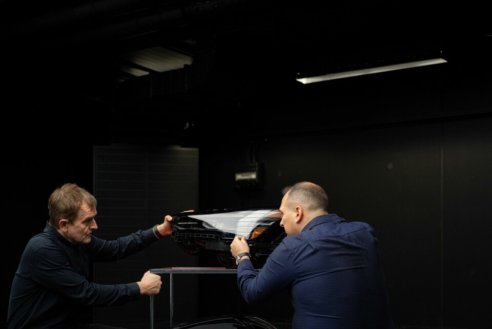

# 细长车灯背后的照明设计

Audi A6 e-tron、Volvo EX90 与 Opel Grandland 的灯组布置和使用取舍。

现在不少车把日行灯做成一条很细的线，主灯却藏在另一片区域里。车头看起来越来越简洁，里面的照明部件并没有消失。本文以 Audi A6 e-tron、Volvo EX90 和 Opel Grandland 为例，分析车灯的造型、结构与照明功能之间的关系。

图注：Audi A6 Avant e-tron。上部为纤细的日行灯，下部暗色区域容纳主要照明部件。 [原始出处](https://www.audi.com/en/photos/album/audi-a6-avant-e-tron-2592)

## 日行灯、主灯与转向信号

日间行车灯主要帮助其他人注意到车辆，近光和远光用于道路照明，转向灯传递方向意图。迎宾动画则是另一种使用情境，发生在人走近车辆时。同一个灯组可以容纳这些不同用途的部件。[1](https://www.iihs.org/research-areas/headlights)[2](https://www.polestar.com/us/manual/polestar-4/2025/article/47d2c97fd33effd3c0a8cc3718c999b7-15e6c6ef2c80fc51c0a8b0976963d3a1-8664b2fa77a7e089c0a8296870d1a409/)

因此，日行灯的轮廓不能直接反映主灯的照明能力。灯带细，不代表照不远；宣传照片中的车头很亮，也不代表夜间道路照得好。判断外形与功能的关系，需要先找到对应的部件。

## Audi A6 e-tron：灯组布置与前脸比例

A6 e-tron 的设计师希望保留概念车低而扁的前脸，但主要照明部件需要较大的空间。团队在访谈中解释，他们把这些部件融入车头的暗色面罩，让上部日行灯保持纤细。[3](https://www.audi.com/en/press-releases/audi-a6-e-tron-as-exciting-as-the-show-car-16122)

这种处理用到了视觉主次。明亮的细线与周围形成明显对比，容易先被注意到；体量较大的部件融进黑色区域，视觉上不那么突出。技术部件得以保留，前脸也没有因为它们的体积而显得笨重。

这里的美观主要服务于部件整合和外观比例，尚不能据此判断照明效果。尤其是主灯位置较低是否更少眩光，需要另外测试，不能从布置方式推算。

## Volvo EX90：开合灯组与迎宾动画

图注：Volvo EX90 的 T 形灯光轮廓，图中灯组处于闭合外观状态。 [原始出处](https://www.cardesignnews.com/lighting/volvo-on-people-awards-win-and-lighting-design/493617)

EX90 同样要协调纤细轮廓与较大的照明模块。设计团队把远光模块放在 T 形灯带后方，让灯带横向部分上下分开，为后方模块让出空间。与 Audi 将部件分区布置不同，Volvo 通过结构开合改变同一位置的状态。[4](https://www.cardesignnews.com/cars/the-volvo-team-unpacks-the-ex90/449332)

品牌还把开合动作做成了类似睁眼的迎宾效果。前者涉及部件的显露，后者希望在人走近时产生情感回应。两者使用了同一结构，评价的重点却不同：照明要看光束，迎宾则要看触发时机和使用者的感受。[5](https://www.volvocars.com/de-ch/news/corporate/volvo-ex90-das-zwinkern-von-thors-hammer/)

图注：团队展示拆离车身的 EX90 灯组。这是部件展示照片，不是拆解图。 [原始出处](https://www.cardesignnews.com/lighting/volvo-on-people-awards-win-and-lighting-design/493617)

为了保留简洁的外形，团队增加了内部结构的复杂度。这也说明，产品外形并不总是被动追随功能；设计师有时会为了某种外观，重新安排结构。增加开合是否值得，还涉及实际体验和长期可靠性，现有资料没有相应耐久比较。[4](https://www.cardesignnews.com/cars/the-volvo-team-unpacks-the-ex90/449332)

一则 EX90 迎宾灯讨论里，发帖者觉得点亮过程有些突兀，也有回复表示喜欢。另有评论提到，在车库里走动时反复触发动画会造成困扰。设计师设想的亲切感，在不同使用频率和场景下，可能得到不同回应。这些是公开用户自述，不能代表所有车主。[6](https://www.reddit.com/r/VolvoEX90/comments/1r6tbjf/opinions_headlight_welcome_sequence/)

## Opel Grandland：根据交通情况调整光束

图注：Opel Grandland 的前脸灯光与发光标志；图中外部图形与道路照明光束属于不同的分析对象。 [原始出处](https://kommunikasjon.ntb.no/pressemelding/18069448/nye-opel-grandland-fra-konsept-til-virkelighet?lang=no&publisherId=16656993)

Grandland 的灯光资料涉及两部分：前脸的发光图形，以及 Intelli-Lux HD 系统的道路照明。前者影响识别和外观，后者处理照射区域。

按 Opel 的说明，摄像头识别前方和对向交通后，系统会调整光束分布。目的在于保留道路需要的照明，同时减少对其他交通参与者的干扰。需要调整的是投向特定位置的光，而不是让整个车头一律更亮或更暗。这是厂商描述的机制和目标，实际效果仍需独立测试。[7](https://www.media.stellantis.com/em-en/opel/press/new-opel-grandland-with-intelli-lux-hd-light-br-scary-nights-a-thing-of-the-past)

因而，发光标志的造型和光束控制应当分别评价。标志可以让车头更有辨识度，但对向驾驶者是否感到刺眼，取决于具体照明系统及其工作条件。

## 照明距离与眩光测试

夜间照明同时关系到本车驾驶者和道路上的其他人。驾驶者需要看清弯道、路边和行人，对向来车的人也需要保持清楚的视线。IIHS 的前灯评价将道路照明与对向眩光一起考察。[1](https://www.iihs.org/research-areas/headlights)

它公布的美规 EX90 结果中，所列 2025—2026 年款配置获得 A，即 Acceptable（可接受）。近光在测试条件下没有超过眩光限值，但缓左弯的照明表现不足。这样的结果比一张点亮的车头照片具体得多：眩光符合要求，不等于每个方向都照得充分。[8](https://www.iihs.org/ratings/vehicle/volvo/ex90-4-door-suv/2025)

这项结果适用于列明的市场和配置，不能直接套给中国或欧洲版本；它也不评价迎宾动画，或行人从路边看灯时的舒适度。目前的资料不足以比较三款车对行人的眩光影响。

#工业设计 #汽车设计 #车灯 #设计与生活

---

## 研究依据（不属于发布正文）

- [1] [IIHS 前灯研究与评价说明](https://www.iihs.org/research-areas/headlights)：评价同时关注道路照明与对向眩光，说明照得亮和不干扰别人需要一起考察。 范围：是方法框架，不是五款车的统一排名；不能用它替代特定车型测试。

- [2] [Polestar 4 2025美规使用手册 行车灯](https://www.polestar.com/us/manual/polestar-4/2025/article/47d2c97fd33effd3c0a8cc3718c999b7-15e6c6ef2c80fc51c0a8b0976963d3a1-8664b2fa77a7e089c0a8296870d1a409/)：可核对灯光模式、手动与自动控制、转向信号及随动灯的功能描述。 范围：手册说明工作方式，不证明双刃轮廓提高照明；配置和地区需另核对。

- [3] [Audi A6 e-tron 外观设计师访谈](https://www.audi.com/en/press-releases/audi-a6-e-tron-as-exciting-as-the-show-car-16122)：设计师说明主要灯光技术部件占空间，融入暗色面罩以维持较扁平的视觉比例。 范围：证明布置与外观目标的协调；不证明下移减少眩光，也不证明美观提升照明。

- [4] [Volvo EX90设计团队访谈](https://www.cardesignnews.com/cars/the-volvo-team-unpacks-the-ex90/449332)：团队希望维持纤细T形轮廓，同时容纳较大的远光模块；模块置于锤形灯带后方，灯带上下分开让路。 范围：迎宾和品牌表达也是设计目标；复杂度增加是团队陈述，不能从中推算故障率或证明最优结构。

- [5] [Volvo瑞士官网 EX90灯组开合说明](https://www.volvocars.com/de-ch/news/corporate/volvo-ex90-das-zwinkern-von-thors-hammer/)：官方将主灯显露与迎宾眨眼分开描述，支持区分照明启用和情感化动画的使用情境。 范围：瑞士市场说明，不能把其中配置套到美规测试车。与C02均来自Volvo叙述，不算两项独立性能验证。

- [6] [EX90车主讨论 迎宾灯动画体验](https://www.reddit.com/r/VolvoEX90/comments/1r6tbjf/opinions_headlight_welcome_sequence/)：同帖既有觉得开灯突兀、车库频繁触发不便的自述，也有喜欢动画的回复。 范围：未核验拥有者身份、软件或配置；不是行人测试，不把担心损坏写成实际故障，不以赞数估算偏好。

- [7] [Opel Grandland Intelli-Lux HD官方说明](https://www.media.stellantis.com/em-en/opel/press/new-opel-grandland-with-intelli-lux-hd-light-br-scary-nights-a-thing-of-the-past)：厂商说明摄像头识别前方和对向交通并调整照射区域；同时另述发光标志和前脸灯光图形。 范围：功能描述与独立实测分开；不将免眩光宣传写成任何情境都不会刺眼，也不把像素数当美感或安全分数。

- [8] [IIHS 2025 Volvo EX90前灯评价](https://www.iihs.org/ratings/vehicle/volvo/ex90-4-door-suv/2025)：该测试列出的美规配置前灯评级A即Acceptable，近光在其测试情境中未超眩光限值；不同弯道照明表现并不一致。 范围：不等于所有现实情境均舒适，不测迎宾动画体验；不外推到欧洲矩阵配置或中国版本，也不把AEB行人评级当行人眩光测试。
