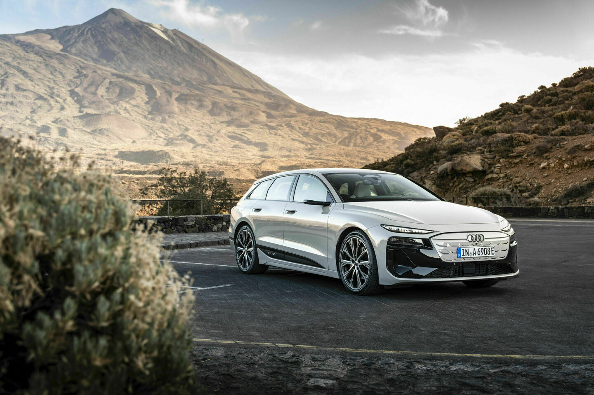
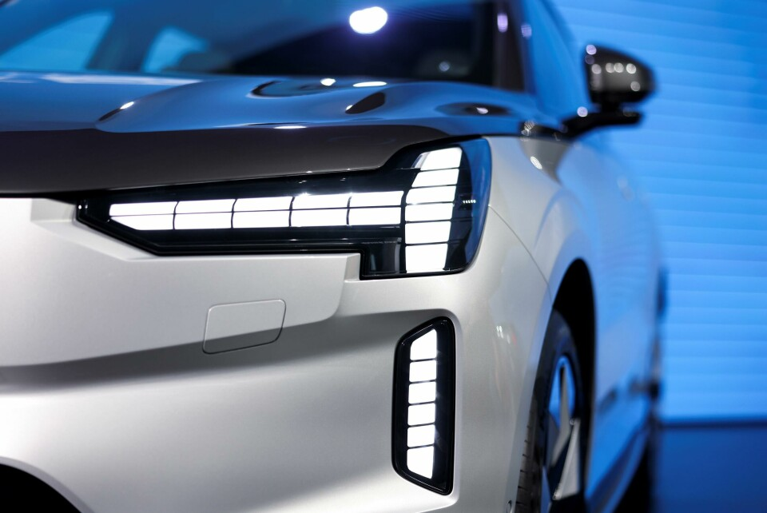
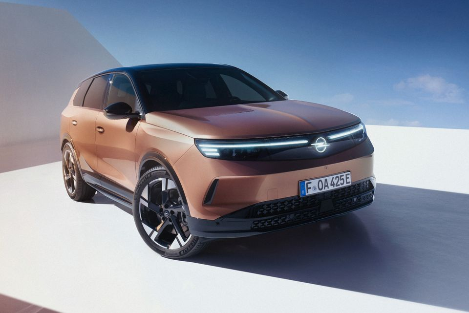

# 细长车灯背后的照明设计

三款车的灯组布置、开合结构与光束控制。

车头那条最醒目的细灯带，未必是夜里照路的主灯。日行灯帮助其他人注意到车辆，近光和远光负责道路照明，转向灯传递方向意图。迎宾动画的用途又不同。它们可以容纳在同一灯组里，但不能只凭发光轮廓判断使用效果。[1](https://www.iihs.org/research-areas/headlights)[2](https://www.polestar.com/us/manual/polestar-4/2025/article/47d2c97fd33effd3c0a8cc3718c999b7-15e6c6ef2c80fc51c0a8b0976963d3a1-8664b2fa77a7e089c0a8296870d1a409/)

## Audi A6 e-tron：灯组布置

图注：Audi A6 Avant e-tron：上部日行灯与下部暗色区域中的主要照明部件分开布置。 [原始出处](https://www.audi.com/en/photos/album/audi-a6-avant-e-tron-2592)

A6 e-tron 的团队希望车头低而扁，主要照明部件却需要空间。他们把较大的部件融入暗色面罩，让上部日行灯维持纤细。[3](https://www.audi.com/en/press-releases/audi-a6-e-tron-as-exciting-as-the-show-car-16122)

明亮细线先被注意到，大部件在黑色背景中不那么突出。这种视觉主次配合了技术布置，但不能证明照明更好，也不能从主灯位置推断眩光更少。

## Volvo EX90：开合结构

图注：Volvo EX90 的 T 形灯光轮廓。 [原始出处](https://www.cardesignnews.com/lighting/volvo-on-people-awards-win-and-lighting-design/493617)

EX90 把较大的远光模块放在 T 形灯带后方，让横向部分上下分开，为模块让路。开合也被做成了类似睁眼的迎宾效果。[4](https://www.cardesignnews.com/cars/the-volvo-team-unpacks-the-ex90/449332)[5](https://www.volvocars.com/de-ch/news/corporate/volvo-ex90-das-zwinkern-von-thors-hammer/)

团队为保留简洁外观增加了结构复杂度。迎宾动画则有不同的用户反馈：公开讨论中，有人觉得点亮突兀，也有人喜欢。几条自述不代表整体偏好，但触发时机与频率确实是实际使用中需要考虑的条件。[6](https://www.reddit.com/r/VolvoEX90/comments/1r6tbjf/opinions_headlight_welcome_sequence/)

## Opel Grandland：光束控制

图注：Opel Grandland 的前脸灯光与发光标志。 [原始出处](https://kommunikasjon.ntb.no/pressemelding/18069448/nye-opel-grandland-fra-konsept-til-virkelighet?lang=no&publisherId=16656993)

Opel 说明，其 Intelli-Lux HD 系统用摄像头识别前方及对向交通，再调整照射区域，目标是兼顾道路照明与对其他人的干扰。这个机制与前脸发光图形的造型不同，不能用标志的辨识度代替照明评价。厂商说明也需要独立测试来验证效果。[7](https://www.media.stellantis.com/em-en/opel/press/new-opel-grandland-with-intelli-lux-hd-light-br-scary-nights-a-thing-of-the-past)

## 夜间照明测试

IIHS 同时评价照明与对向眩光。美规 EX90 所列 2025—2026 年款配置获 A（可接受）：近光在测试条件下未超眩光限值，但缓左弯照明不足。该结果不能套给其他市场的不同配置，也没有评价迎宾动画或行人的观看舒适度。[8](https://www.iihs.org/ratings/vehicle/volvo/ex90-4-door-suv/2025)[1](https://www.iihs.org/research-areas/headlights)

#工业设计 #汽车设计 #车灯 #设计与生活

---

## 研究依据（不属于发布正文）

- [1] [IIHS 前灯研究与评价说明](https://www.iihs.org/research-areas/headlights)：评价同时关注道路照明与对向眩光，说明照得亮和不干扰别人需要一起考察。 范围：是方法框架，不是五款车的统一排名；不能用它替代特定车型测试。

- [2] [Polestar 4 2025美规使用手册 行车灯](https://www.polestar.com/us/manual/polestar-4/2025/article/47d2c97fd33effd3c0a8cc3718c999b7-15e6c6ef2c80fc51c0a8b0976963d3a1-8664b2fa77a7e089c0a8296870d1a409/)：可核对灯光模式、手动与自动控制、转向信号及随动灯的功能描述。 范围：手册说明工作方式，不证明双刃轮廓提高照明；配置和地区需另核对。

- [3] [Audi A6 e-tron 外观设计师访谈](https://www.audi.com/en/press-releases/audi-a6-e-tron-as-exciting-as-the-show-car-16122)：设计师说明主要灯光技术部件占空间，融入暗色面罩以维持较扁平的视觉比例。 范围：证明布置与外观目标的协调；不证明下移减少眩光，也不证明美观提升照明。

- [4] [Volvo EX90设计团队访谈](https://www.cardesignnews.com/cars/the-volvo-team-unpacks-the-ex90/449332)：团队希望维持纤细T形轮廓，同时容纳较大的远光模块；模块置于锤形灯带后方，灯带上下分开让路。 范围：迎宾和品牌表达也是设计目标；复杂度增加是团队陈述，不能从中推算故障率或证明最优结构。

- [5] [Volvo瑞士官网 EX90灯组开合说明](https://www.volvocars.com/de-ch/news/corporate/volvo-ex90-das-zwinkern-von-thors-hammer/)：官方将主灯显露与迎宾眨眼分开描述，支持区分照明启用和情感化动画的使用情境。 范围：瑞士市场说明，不能把其中配置套到美规测试车。与C02均来自Volvo叙述，不算两项独立性能验证。

- [6] [EX90车主讨论 迎宾灯动画体验](https://www.reddit.com/r/VolvoEX90/comments/1r6tbjf/opinions_headlight_welcome_sequence/)：同帖既有觉得开灯突兀、车库频繁触发不便的自述，也有喜欢动画的回复。 范围：未核验拥有者身份、软件或配置；不是行人测试，不把担心损坏写成实际故障，不以赞数估算偏好。

- [7] [Opel Grandland Intelli-Lux HD官方说明](https://www.media.stellantis.com/em-en/opel/press/new-opel-grandland-with-intelli-lux-hd-light-br-scary-nights-a-thing-of-the-past)：厂商说明摄像头识别前方和对向交通并调整照射区域；同时另述发光标志和前脸灯光图形。 范围：功能描述与独立实测分开；不将免眩光宣传写成任何情境都不会刺眼，也不把像素数当美感或安全分数。

- [8] [IIHS 2025 Volvo EX90前灯评价](https://www.iihs.org/ratings/vehicle/volvo/ex90-4-door-suv/2025)：该测试列出的美规配置前灯评级A即Acceptable，近光在其测试情境中未超眩光限值；不同弯道照明表现并不一致。 范围：不等于所有现实情境均舒适，不测迎宾动画体验；不外推到欧洲矩阵配置或中国版本，也不把AEB行人评级当行人眩光测试。
