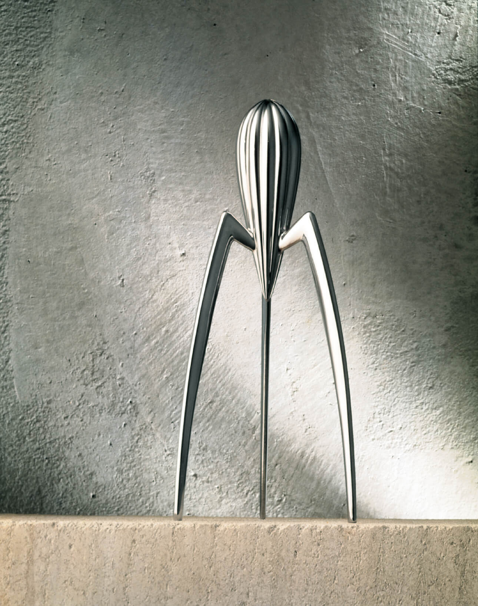
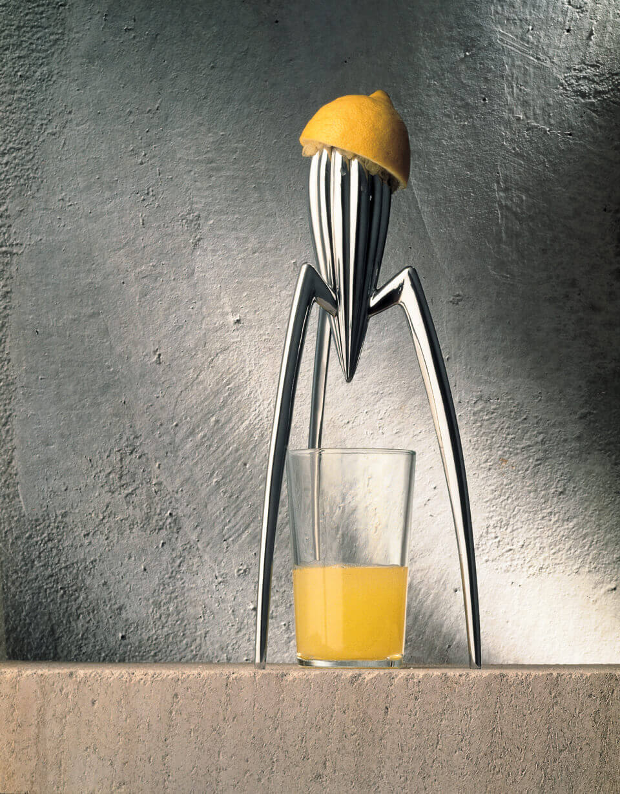

# Juicy Salif 的造型与使用

比例、负空间与线条，以及它们与接汁操作的关系。

Juicy Salif 是一台三脚柑橘榨汁器：长腿托起带沟槽的主体，下方没有接汁容器，也没有筛网。它的造型很有辨识度，但使用时仍需要安排好杯子、扶持和过滤。

图注：经典银色 Juicy Salif，支腿之间留出杯子空间。 [原始出处](https://www.starck.com/juicy-salif-alessi-p2009)

## 杯子空间

Alessi 将长腿与下方的杯子空间联系起来。果实在上方挤压，杯子在下方直接接汁，不必先接到另一个容器里。[1](https://us.alessi.com/products/juicy-salif-citrus-squeezer)

三条腿之间的空隙，是造型中的“负空间”。较饱满的主体在上，细长支腿与大片空隙在下，形成实体与空白的对比，使下部显得通透。杯子放入以后，这块空隙就成为接汁空间。

## 双手操作

图注：柠檬与杯子的摆放关系；图中没有展示双手操作。 [原始出处](https://www.starck.com/juicy-salif-alessi-p2009)

说明书要求把器具放稳，一手扶住某条支腿的上部，另一手拿半个果实，轻压并缓慢转动。扶持与按压需要配合，现有资料没有证明它比同类产品更省力。[2](https://storage.alessiaustralia.com.au/PSJS.en.pdf?focal=none&mtime=20210216091407)

## 轮廓与线条

主体从宽处逐渐缩到下方尖端，表面沟槽也向下收拢，形成视觉上的“收束”。重复的沟槽带来线条节奏，向外展开的支腿则撑开外围空间。中央尖端与下方杯口相对，形式上的集中位置也对应了接汁位置。

## 接汁与过滤

Aberdeen 博物馆的说明提到，汁会直接流进杯子，籽和果肉也会一起进入。需要去籽的人仍得另外过滤。[3](https://emuseum.aberdeencity.gov.uk/objects/89829/juicy-salif-citrus-squeezer)

minimalgoods 的作者写到，他会加一块砧板，再用小滤网接籽。器具自身没有筛网，不等于使用过程可以省去过滤；这取决于使用者对汁液的要求。[4](https://minimalgoods.co/article/juicy-salif-review)

## 清洗与摆放

经典款需要及时冲洗、擦干，避免磨蚀性清洁用品，也不能放进洗碗机。习惯手洗的人可能可以接受，习惯洗碗机的人则要单独照顾它。[2](https://storage.alessiaustralia.com.au/PSJS.en.pdf?focal=none&mtime=20210216091407)

公开讨论里，有人重视它平时摆着看的愉悦，也有人更介意接汁和收纳。几条自述不能算成满意率，但呈现了不同的使用期待：偶尔榨汁并愿意陈列，和频繁使用、希望尽快收拾完，对便利性的要求并不相同。[5](https://www.reddit.com/r/DesignDesign/comments/o1hffd/for_me_the_juicy_salif_is_the_pinnacle_of_design/)

#工业设计 #产品设计 #JuicySalif #设计与生活

---

## 研究依据（不属于发布正文）

- [1] [Alessi Juicy Salif官方产品页](https://us.alessi.com/products/juicy-salif-citrus-squeezer)：支持PSJS经典款身份、铸铝材料和长腿为杯子留空间的产品说明。 范围：功能性和畅销等宣传不能替代测试；经典款、镀金及青铜版本不能混用。

- [2] [Alessi署名 PSJS英文使用说明书](https://storage.alessiaustralia.com.au/PSJS.en.pdf?focal=none&mtime=20210216091407)：规定稳固放置、杯子在下方、一手扶支脚上部另一手轻压慢转；还规定及时冲洗擦干、禁用洗碗机，脚垫可更换。 范围：是规范操作，不是稳定性或清洁速度实验。页首1998与MoMA1988及品牌投产1990记录冲突，因此不用它判设计年份。

- [3] [Aberdeen博物馆 Juicy Salif藏品说明](https://emuseum.aberdeencity.gov.uk/objects/89829/juicy-salif-citrus-squeezer)：汁液直接流入杯子，籽和果肉也会一起进入，可作为接汁与过滤取舍的说明。 范围：不是效率或人体工学测试；馆藏对目标人群的解释不当作有抽样数据的真实购买画像。

- [4] [minimalgoods Juicy Salif使用文章](https://minimalgoods.co/article/juicy-salif-review)：作者自述使用时加放砧板、用小筛网接籽，并仍重视它在厨房中的陈列价值。 范围：非受控比较试验；不采其必然掉脚垫或更好用等泛化推断，历史和材料转述另核，不借用无法追溯的设计师语录。

- [5] [Reddit Juicy Salif长期拥有者与试用者讨论](https://www.reddit.com/r/DesignDesign/comments/o1hffd/for_me_the_juicy_salif_is_the_pinnacle_of_design/)：有拥有者重视少量使用之外的日常陈列愉悦，也有试用者不满意接汁；对收纳和清洁的感受同样不同。 范围：自选样本、型号与使用方法未统一，不能统计成满意率或证实效率；传闻与真正自述分开，不采用评论者声称客观最差的结论。
